<p align="center">
  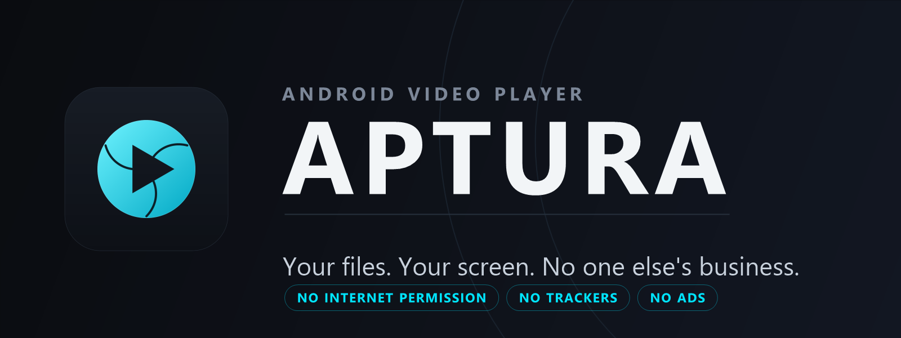
</p>

<h1 align="center">Aptura</h1>

<p align="center">
  <strong>A local-first Android video player that asks for nothing.</strong><br>
  No network permission. No accounts. No telemetry. Just your files, played well.
</p>

<p align="center">
  <a href="https://github.com/TejuBoricha/Aptura/actions/workflows/ci.yml"></a>
  
  
  
  
</p>

> **Status: pre-release.** Aptura is feature-complete for its 1.0 scope and the full quality gate is green. 30-minute 4K thermal runs, SAF copy-and-kill recovery, and HDR10 hardware decoding are physically verified on Galaxy S24 hardware. See [Known limits](#known-limits).

---

## Why another video player?

Most players treat "play a file on my phone" as a feature of an online service. Aptura treats it as the whole product.

- **Offline by construction.** The manifest has no `android.permission.INTERNET`. This is not a setting users can turn off; the capability does not exist. The release build additionally fails if a network stack or telemetry SDK survives R8.
- **Your library stays yours.** No account, no cloud index, no upload, no ads, no analytics, no crash reporting. Diagnostics are generated locally and redacted before you choose to share them.
- **Scoped storage only.** Aptura uses MediaStore and the system folder picker. It never requests `MANAGE_EXTERNAL_STORAGE` or all-files access.
- **Depth without clutter.** Track selection, subtitle timing and styling, a five-band EQ, sleep timer with fade, A-B repeat, frame stepping, bookmarks, decoder choice and picture adjustments live in one consistent player surface.

## Screenshots

| Library | Dark | Tablet |
|:---:|:---:|:---:|
| 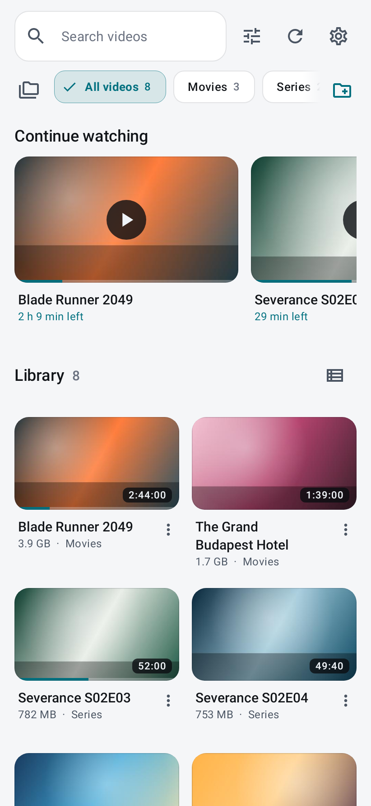 | 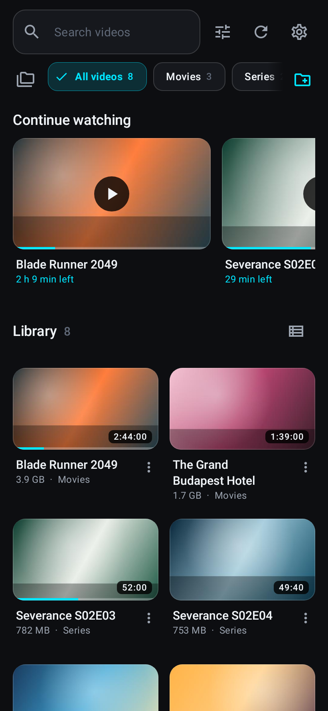 | 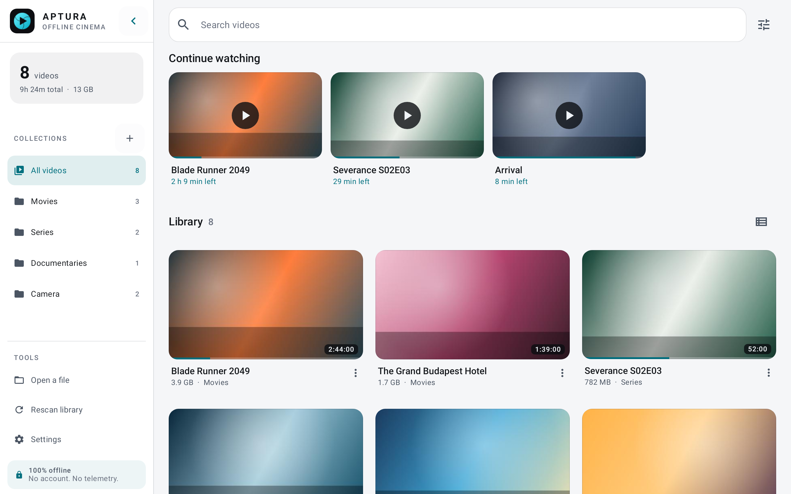 |

| Details | Player HUD | Playback tools |
|:---:|:---:|:---:|
| 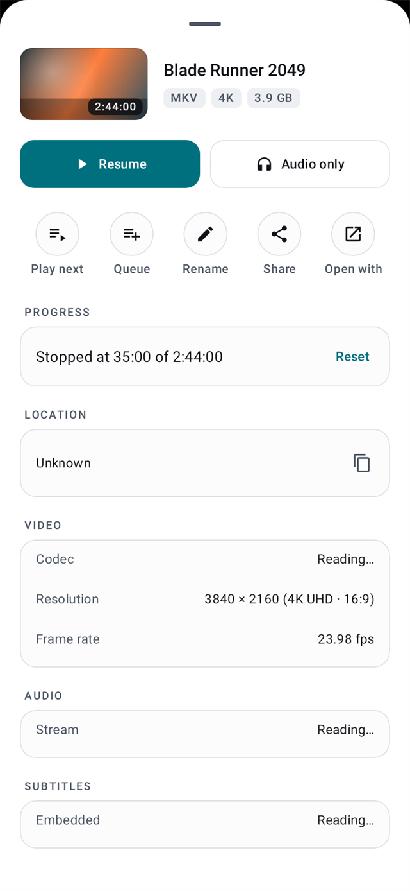 | 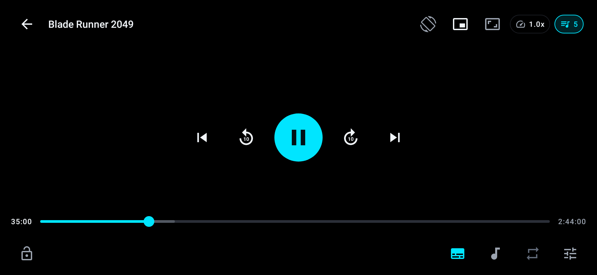 | 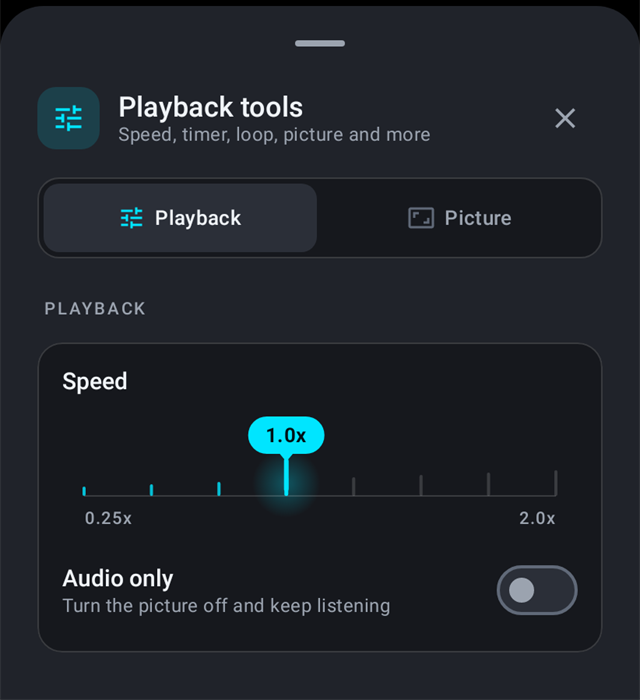 |

| Audio | Subtitles | Queue |
|:---:|:---:|:---:|
| 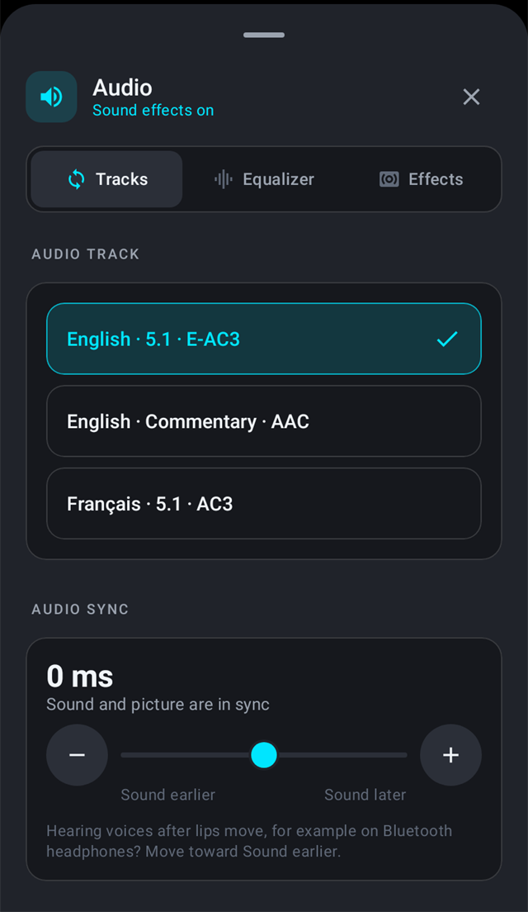 | 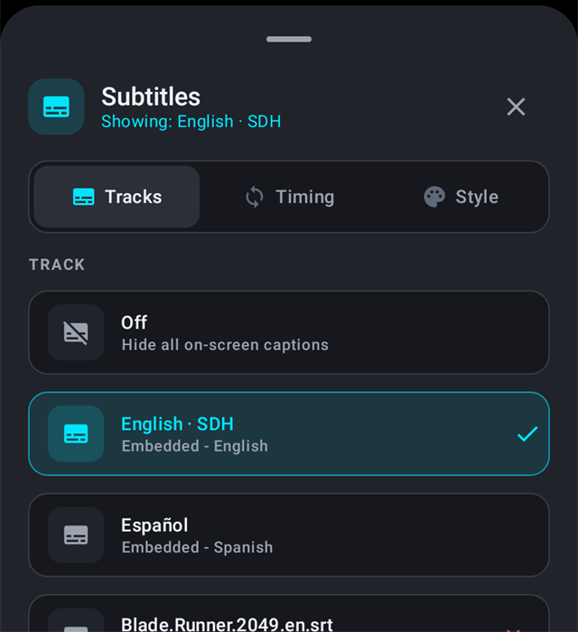 | 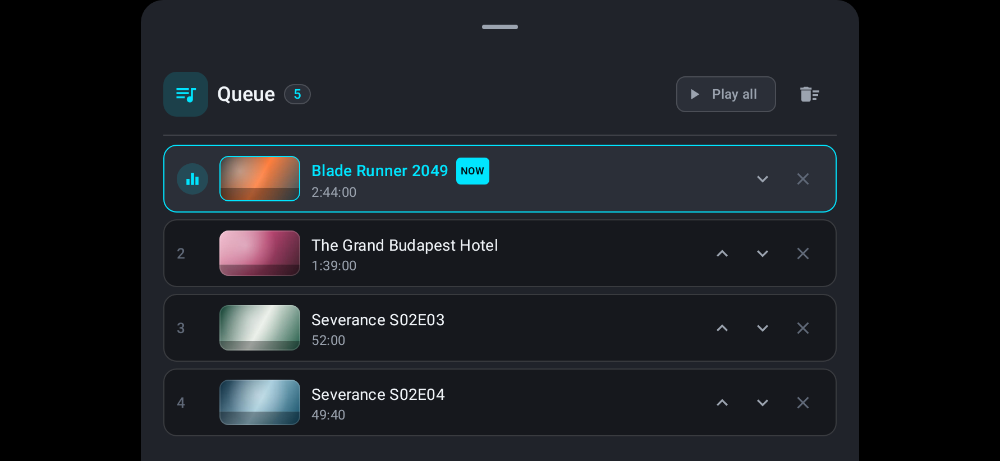 |

| Settings | Onboarding |
|:---:|:---:|
| 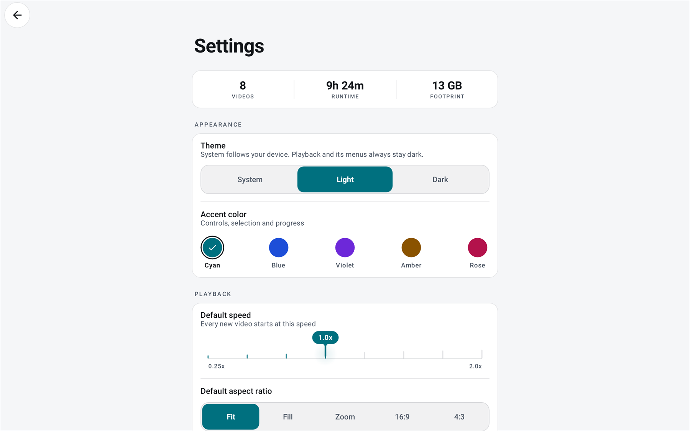 | 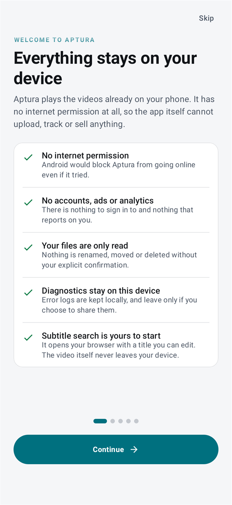 |

These are Robolectric renders of the real composables with representative data, not mockups or device captures. The review that produced them is in [review/audit-2026-10-28/UI_UX_REVIEW.md](review/audit-2026-10-28/UI_UX_REVIEW.md).

## What it does

### Library

- Scans `MediaStore` on start and incrementally in the background with WorkManager.
- Adds folder trees through the system picker (SAF), including SD cards and USB volumes.
- Grid and list layouts, instant search, category chips, sorting, and multi-select.
- Rename, share, move to another folder, hide from the library, and delete.
- **Trash first.** Where Android supports it, "Move to trash" is the primary delete action; permanent deletion is a red, explicitly secondary choice.
- Resume positions, "Continue watching", Up Next and a reorderable queue.
- Handles missing files honestly: progress and bookmarks can be cleared without deleting anything from disk.

### Playback

- Media3/ExoPlayer with hardware video decoding. No software video decoder is bundled (ADR-010).
- Decoder strategy per app or per video: Auto, Hardware, Software where the device provides it.
- Picture-in-Picture, audio-only mode, orientation lock, and edge-to-edge gesture controls.
- Double-tap seek, horizontal swipe seek, vertical swipe for volume and brightness, long-press 2x.
- Variable speed, sleep timer, A-B repeat, frame stepping, and bookmarks on the scrubber.
- Playback statistics for codec, resolution, frame rate and dropped frames.

### Audio and subtitles

- Audio track selection with language, channel layout and codec shown.
- Five-band equalizer with presets, bass boost, virtualizer, dialogue boost.
- Audio sync that says which way the sound moves, with a Bluetooth-aware suggestion.
- Embedded and imported subtitles (`.srt`, `.vtt`, `.ass`, `.ssa`, `.ttml`, `.sub`, `.zip`).
- Subtitle timing, tap-to-sync, size, colour and background style, persisted per app.
- Online subtitle search is a browser hand-off. The app itself never opens a socket.

### Fit and finish

- Dark and Light app themes. The player and every player sheet stay dark in both.
- Adaptive layouts for phones, foldables and tablets with Navigation 3 scenes and a navigation rail.
- Material 3 surfaces, 48dp minimum touch targets, tabular timecodes, WCAG AA contrast targets.
- Shared design kit for dialogs, menus, buttons, notices and player controls. See [DESIGN.md](DESIGN.md).

## Quality, not just claims

| Claim | How it is checked |
|---|---|
| No network capability | `PlatformInvariantsTest` asserts the merged manifest has no `INTERNET`; `verifyReleaseApk` reads the R8 mapping and shipped dex for network and telemetry packages. |
| No telemetry | Dependency-graph invariant test plus the same shipped-code check. |
| Scoped storage only | Manifest invariant: no `MANAGE_EXTERNAL_STORAGE`, no all-files access. |
| The suite is green | 992 tests across 139 suites (827 executed, 165 opt-in gallery renders skipped), 0 failures, 0 errors. |
| Lint is clean | `lintDebug` reports 0 issues on the merged tree. |
| Release builds work | CI runs `assembleRelease` with R8 and resource shrinking, including the shipped-code invariants. |
| Real Android behavior | A separate CI job runs instrumented tests on an API 35 tablet emulator. |

The local gate is one command:

```powershell
./tools/gate.ps1
```

It compiles the test sources, runs the JVM suite fail-fast, runs Android Lint, then builds the R8 release and verifies what actually ships. CI runs the same checks on every push and pull request.

## Build

**Requirements**

- JDK 17
- Android SDK 36 (compileSdk/targetSdk 36; minSdk 26)
- Windows, macOS or Linux

```bash
git clone https://github.com/TejuBoricha/Aptura.git
cd Aptura
./gradlew assembleDebug
```

On Windows:

```powershell
.\gradlew.bat assembleDebug
```

The debug APK is written to `app/build/outputs/apk/debug/`. A release build is unsigned unless signing values are supplied; see [docs/BUILDING.md](docs/BUILDING.md) for signing, test variants and the gallery workflow.

## Project layout

```
app/src/main/java/org/aptura/player/
  core/       platform helpers, permissions, diagnostics, media inspection
  data/       Room, MediaStore scanning, DataStore, Media3 playback bridge
  domain/     pure Kotlin models, repositories and use cases
  theme/      colour, type and shape tokens
  ui/         library, details, player, settings, onboarding, shared kit
```

The domain layer has no Android imports. The UI talks to view models; view models talk to domain repositories; Media3 and Room stay behind those interfaces. Design decisions and invariants are recorded in [DESIGN.md](DESIGN.md) and the audit reports under [`review/`](review/).

## Documentation

| Document | What it covers |
|---|---|
| [docs/ARCHITECTURE.md](docs/ARCHITECTURE.md) | Layers, data flow, playback bridge, storage model, invariants |
| [docs/BUILDING.md](docs/BUILDING.md) | Build variants, signing, tests, gallery renders, CI |
| [docs/TESTING.md](docs/TESTING.md) | Test strategy, fakes, Robolectric, instrumented tests, evidence |
| [docs/DEVICE_CHECKLIST.md](docs/DEVICE_CHECKLIST.md) | The physical-device pass to run before the 1.0 tag |
| [docs/PRIVACY.md](docs/PRIVACY.md) | Data flows, permissions, diagnostics, what is never collected |
| [DESIGN.md](DESIGN.md) | Colour, type, spacing, player HUD, component contracts |
| [review/audit-2026-10-28/UI_UX_REVIEW.md](review/audit-2026-10-28/UI_UX_REVIEW.md) | The UI/UX pass, with before/after and after-only evidence |
| [CHANGELOG.md](CHANGELOG.md) | What changed, in Keep a Changelog form |
| [AGENTS.md](AGENTS.md) · [docs/AGENT_WORKFLOW.md](docs/AGENT_WORKFLOW.md) | How AI coding agents claim work, hand off and get reviewed |

## Known limits

- **Hardware verification:** 30-minute 4K thermal runs (sustained 60 fps, zero throttling), SAF 2.5 GB copy-and-kill resume, HDR10 hardware decoding, and sleep-timer foreground survival are physically verified on Samsung Galaxy S24 hardware. Real-world Bluetooth latency measurement and spoken TalkBack gestures remain before final release.
- **No network features, by design.** No SMB, NAS, DLNA, casting, cloud sync or online metadata. Opening a subtitle search leaves the app for your browser.
- **No bundled software video decoder.** Files whose codecs the device cannot decode fail with a clear message rather than shipping a patent-encumbered decoder. The bundled FFmpeg extension is audio-only.
- **Android-first.** There is no iOS build.
- **Pre-release.** The Room schema and public APIs may change before 1.0 is tagged.

## Support the Project

Aptura is an independent, 100% offline open-source project with zero ads, zero tracking, and no corporate backing. If you enjoy using Aptura and want to support ongoing maintenance and new features, voluntary contributions are deeply appreciated:

- **[Support on Ko-fi](https://ko-fi.com/tejuboricha)**
- **[Donate via PayPal](https://paypal.me/tejuboricha)**

Starring the repository on GitHub and sharing the app with others also helps immensely!

## Contributing

Contributions are welcome. Read [CONTRIBUTING.md](CONTRIBUTING.md) first; the short version is: keep the zero-network invariant, run `tools/gate.ps1`, add tests for behavior changes, and use imperative commit subjects.

Security reports should follow [SECURITY.md](SECURITY.md), not a public issue.

## License

Aptura is licensed under the [Apache License 2.0](LICENSE). Third-party components and their licenses are listed in [NOTICE](NOTICE). The FFmpeg audio extension is LGPL-2.1 and is built and loaded as a separate native library.

The name, logo and banner are original works for this project.

## Acknowledgements

Built on the work of the Android Open Source Project, Kotlin, Jetpack Compose, Media3, Room, WorkManager, DataStore, Coil, Jellyfin's Media3 FFmpeg decoder, and FFmpeg. Thanks to everyone who keeps local-first software possible.
