<p align="center">
  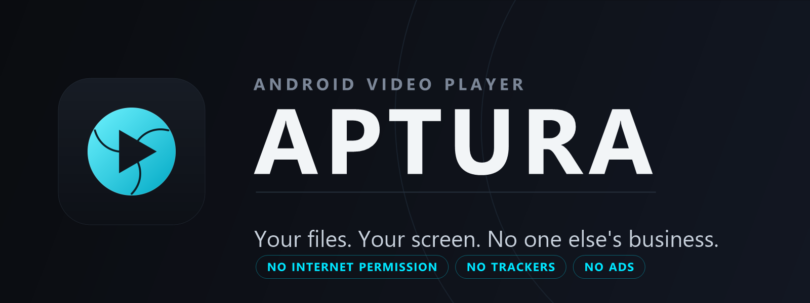
</p>

<h1 align="center">Aptura</h1>

<p align="center">
  <strong>A local-first Android video player that asks for nothing.</strong><br>
  No network permission. No accounts. No telemetry. Just your files, played well.
</p>

<p align="center">
  <a href="https://github.com/TejuBoricha/Aptura/actions/workflows/ci.yml"></a>
  
  
  
  
</p>

> **Status: pre-release.** Aptura is feature-complete for its 1.0 scope and the full quality gate is green. A 30-minute 4K thermal run and SAF copy-and-kill recovery passed on one Galaxy S24, HDR10 decoding was a partial pass, and TalkBack, Bluetooth and real-phone retests of the recent fixes are still open. See the [device checklist](docs/DEVICE_CHECKLIST.md) and [Known limits](#known-limits).

---

## Why another video player?

Most players treat "play a file on my phone" as a feature of an online service. Aptura treats it as the whole product.

- **Offline by construction.** The manifest has no `android.permission.INTERNET`. This is not a setting users can turn off; the capability does not exist. The release build additionally fails if a network stack or telemetry SDK survives R8.
- **Your library stays yours.** No account, no cloud index, no upload, no ads, no analytics, no crash reporting. Diagnostics are generated locally and redacted before you choose to share them.
- **Scoped storage only.** Aptura uses MediaStore and the system folder picker. It never requests `MANAGE_EXTERNAL_STORAGE` or all-files access.
- **Depth without clutter.** Track selection, subtitle timing and styling, a five-band EQ, sleep timer with fade, A-B repeat, frame stepping, bookmarks, decoder choice and picture adjustments live in one consistent player surface.

## Screenshots

| Library | Dark | Tablet |
|:---:|:---:|:---:|
| 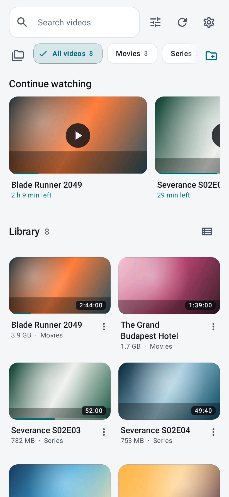 | 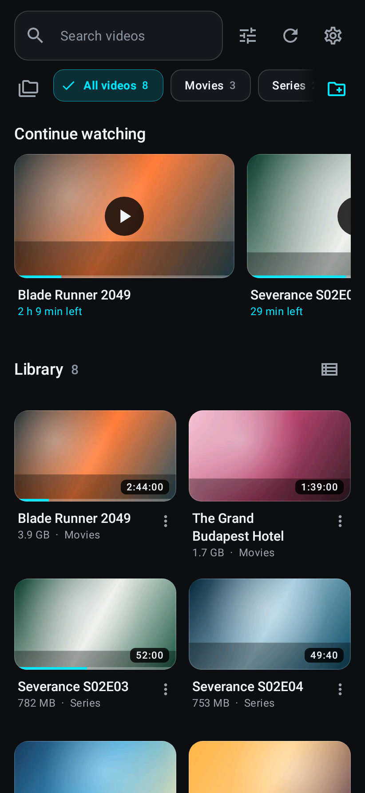 | 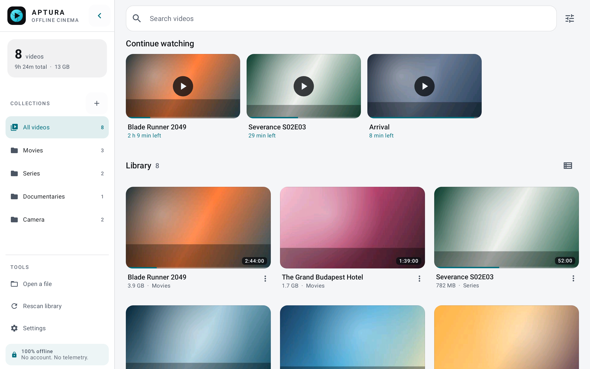 |

| Details | Player HUD | Playback tools |
|:---:|:---:|:---:|
| 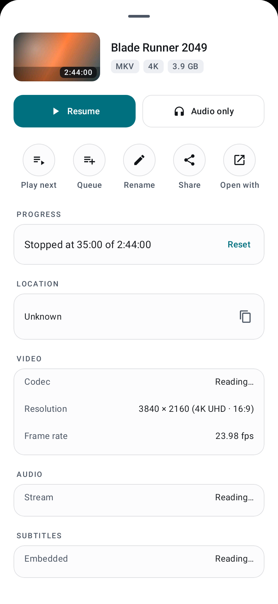 | 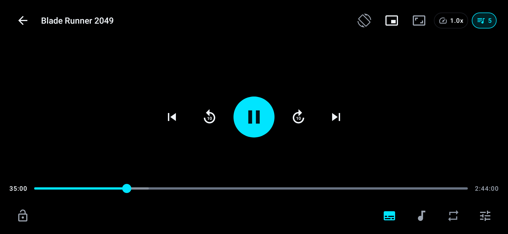 | 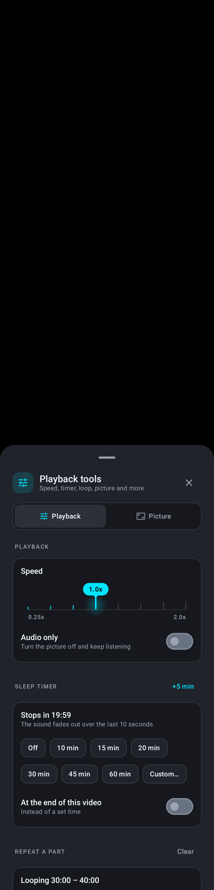 |

| Audio | Subtitles | Queue |
|:---:|:---:|:---:|
| 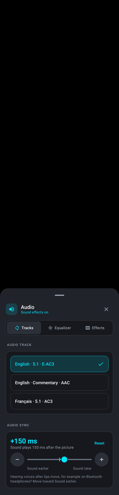 | 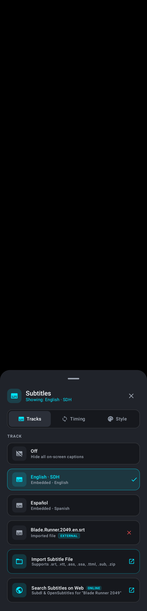 | 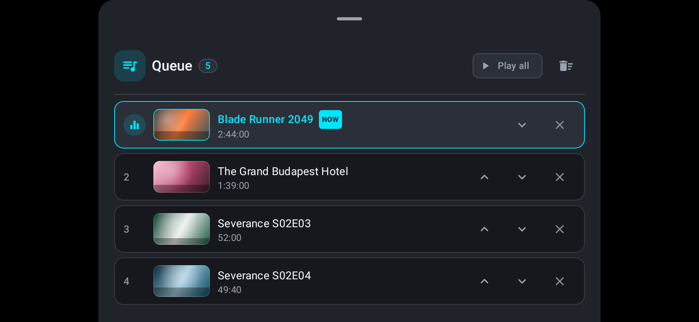 |

| Settings | Onboarding |
|:---:|:---:|
| 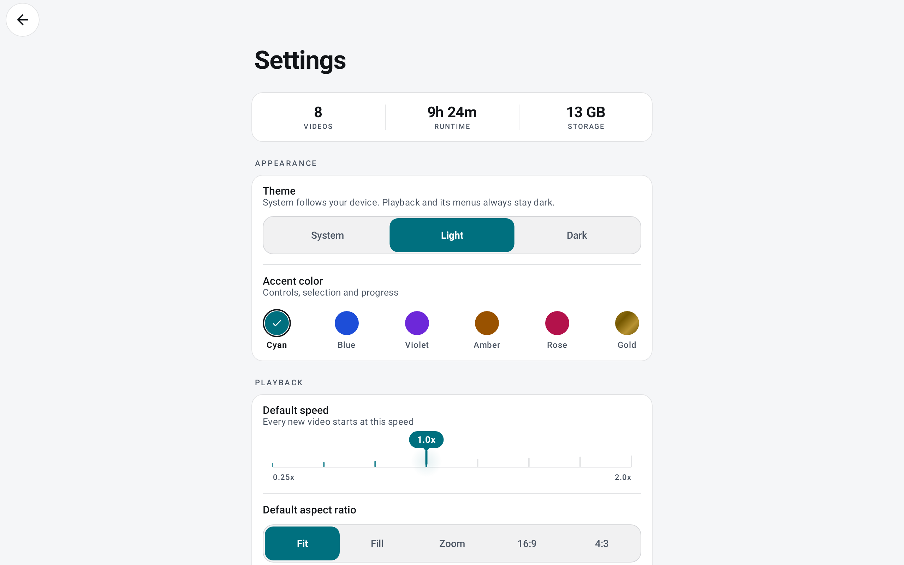 | 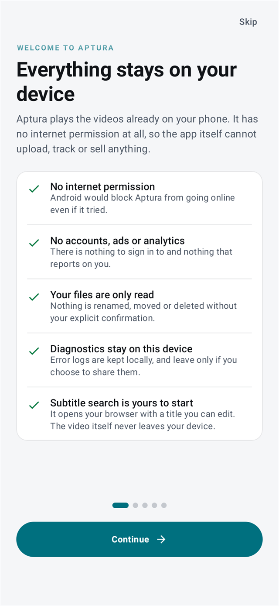 |

These are Robolectric renders of the real composables with representative data, not mockups or device captures.

## What it does

### Library

- Scans `MediaStore` on start and incrementally in the background with WorkManager.
- Adds folder trees through the system picker (SAF), including SD cards and USB volumes.
- Grid and list layouts, instant search, category chips, sorting, and multi-select.
- Rename, share, move to another folder, hide from the library, and delete.
- **Trash first.** Where Android supports it, "Move to trash" is the primary delete action; permanent deletion is a red, explicitly secondary choice.
- Resume positions, "Continue watching", Up Next and a reorderable queue.
- Handles missing files honestly: progress and bookmarks can be cleared without deleting anything from disk.

### Playback

- Media3/ExoPlayer with hardware video decoding. No software video decoder is bundled (ADR-010).
- Decoder strategy per app or per video: Auto, Hardware, Software where the device provides it.
- Picture-in-Picture, audio-only mode, orientation lock, and edge-to-edge gesture controls.
- Double-tap seek, horizontal swipe seek, vertical swipe for volume and brightness, long-press 2x.
- Variable speed, sleep timer, A-B repeat, frame stepping, and bookmarks on the scrubber.
- Playback statistics for codec, resolution, frame rate and dropped frames.

### Audio and subtitles

- Audio track selection with language, channel layout and codec shown.
- Five-band equalizer with presets, bass boost, virtualizer, dialogue boost.
- Audio sync that says which way the sound moves, with a Bluetooth-aware suggestion.
- Embedded and imported subtitles (`.srt`, `.vtt`, `.ass`, `.ssa`, `.ttml`, `.sub`, `.zip`).
- Subtitle timing, tap-to-sync, size, colour and background style, persisted per app.
- Online subtitle search is a browser hand-off. The app itself never opens a socket.

### Fit and finish

- Dark and Light app themes. The player and every player sheet stay dark in both.
- Adaptive layouts for phones, foldables and tablets with Navigation 3 scenes and a navigation rail.
- Material 3 surfaces, 48dp minimum touch targets, tabular timecodes, WCAG AA contrast targets.
- Shared design kit for dialogs, menus, buttons, notices and player controls. See [DESIGN.md](DESIGN.md).

## Quality, not just claims

| Claim | How it is checked |
|---|---|
| No network capability | `PlatformInvariantsTest` asserts the merged manifest has no `INTERNET`; `verifyReleaseApk` reads the R8 mapping and shipped dex for network and telemetry packages. |
| No telemetry | Dependency-graph invariant test plus the same shipped-code check. |
| Scoped storage only | Manifest invariant: no `MANAGE_EXTERNAL_STORAGE`, no all-files access. |
| The suite is green | 992 tests across 139 suites (827 executed, 165 opt-in gallery renders skipped), 0 failures, 0 errors. |
| Lint is clean | `lintDebug` reports 0 issues on the merged tree. |
| Release builds work | CI runs `assembleRelease` with R8 and resource shrinking, including the shipped-code invariants. |
| Real Android behavior | A separate CI job runs instrumented tests on an API 35 tablet emulator. |

The local gate is one command:

```powershell
./tools/gate.ps1
```

It compiles the test sources, runs the JVM suite fail-fast, runs Android Lint, then builds the R8 release and verifies what actually ships. CI runs the same checks on every push and pull request.

## Build

**Requirements**

- JDK 17
- Android SDK 36 (compileSdk/targetSdk 36; minSdk 26)
- Windows, macOS or Linux

```bash
git clone https://github.com/TejuBoricha/Aptura.git
cd Aptura
./gradlew assembleDebug
```

On Windows:

```powershell
.\gradlew.bat assembleDebug
```

The debug APK is written to `app/build/outputs/apk/debug/`. A release build is unsigned unless signing values are supplied; see [docs/BUILDING.md](docs/BUILDING.md) for signing, test variants and the gallery workflow.

## Project layout

```
app/src/main/java/org/aptura/player/
  core/       platform helpers, permissions, diagnostics, media inspection
  data/       Room, MediaStore scanning, DataStore, Media3 playback bridge
  domain/     pure Kotlin models, repositories and use cases
  theme/      colour, type and shape tokens
  ui/         library, details, player, settings, onboarding, shared kit
```

The domain layer has no Android imports. The UI talks to view models; view models talk to domain repositories; Media3 and Room stay behind those interfaces. Design decisions and invariants are recorded in [DESIGN.md](DESIGN.md) and the current audit is [docs/audits/CURRENT_AUDIT.md](docs/audits/CURRENT_AUDIT.md).

## Documentation

| Document | What it covers |
|---|---|
| [docs/ARCHITECTURE.md](docs/ARCHITECTURE.md) | Layers, data flow, playback bridge, storage model, invariants |
| [docs/BUILDING.md](docs/BUILDING.md) | Build variants, signing, tests, gallery renders, CI |
| [docs/TESTING.md](docs/TESTING.md) | Test strategy, fakes, Robolectric, instrumented tests, evidence |
| [docs/DEVICE_CHECKLIST.md](docs/DEVICE_CHECKLIST.md) | The physical-device pass to run before the 1.0 tag |
| [docs/PRIVACY.md](docs/PRIVACY.md) | Data flows, permissions, diagnostics, what is never collected |
| [DESIGN.md](DESIGN.md) | Colour, type, spacing, player HUD, component contracts |
| [docs/audits/CURRENT_AUDIT.md](docs/audits/CURRENT_AUDIT.md) | The one active audit: findings, roadmap and progress |
| [CHANGELOG.md](CHANGELOG.md) | What changed, in Keep a Changelog form |
| [AGENTS.md](AGENTS.md) · [docs/AGENT_WORKFLOW.md](docs/AGENT_WORKFLOW.md) | Coding rules, hot files, attribution and review gates |

## Known limits

- **Hardware verification:** on one Samsung Galaxy S24 (2026-10-29, over adb, nothing judged by ear) a 30-minute 4K HEVC run on USB power showed no throttling and no dropped frames, and a 2.5 GB SAF copy killed at 42% recovered. HDR10 decoding was a partial pass (tone mapping not judged). The sleep timer was lost when the task was removed; a fix was merged but not retested on a device. Bluetooth, TalkBack and the fixes made after the audit still need a physical-device pass ([checklist](docs/DEVICE_CHECKLIST.md)).
- **No network features, by design.** No SMB, NAS, DLNA, casting, cloud sync or online metadata. Opening a subtitle search leaves the app for your browser.
- **No bundled software video decoder.** Files whose codecs the device cannot decode fail with a clear message rather than shipping a patent-encumbered decoder. The bundled FFmpeg extension is audio-only and decodes just ALAC and G.711 A-law and mu-law; every other format is left to the device's own decoders.
- **Android-first.** There is no iOS build.
- **Pre-release.** The Room schema and public APIs may change before 1.0 is tagged.

## Support the Project

Aptura is an independent, 100% offline open-source project with zero ads, zero tracking, and no corporate backing. If you enjoy using Aptura and want to support ongoing maintenance and new features, voluntary contributions are deeply appreciated:

- **[Support on Ko-fi](https://ko-fi.com/tejuboricha)**
- **[Donate via PayPal](https://paypal.me/tejuboricha)**

Starring the repository on GitHub and sharing the app with others also helps immensely!

## Contributing

Contributions are welcome. Read [CONTRIBUTING.md](CONTRIBUTING.md) first; the short version is: keep the zero-network invariant, run `tools/gate.ps1`, add tests for behavior changes, and use imperative commit subjects.

Security reports should follow [SECURITY.md](SECURITY.md), not a public issue.

## License

Aptura is licensed under the [Apache License 2.0](LICENSE). Third-party components and their licenses are listed in [NOTICE](NOTICE) and shown inside the app (Settings, Open-source licences). The FFmpeg audio extension is FFmpeg n9.0.2, built by this project from unmodified upstream source as separate LGPL-2.1 shared libraries that contain only the ALAC and G.711 decoders. The exact source, the build records and the licence texts are published beside the binaries in the [`ffmpeg-audio-n9.0.2-r1` release](https://github.com/TejuBoricha/Aptura/releases/tag/ffmpeg-audio-n9.0.2-r1), and `gradle/ffmpeg-bundle.properties` pins the checksum the build accepts. The research behind that choice is in [spec/11B](spec/11B_LEGAL_RESEARCH_FINDINGS.md); it was done without a lawyer and is not legal advice or a clearance.

The name, logo and banner are original works for this project.

## Acknowledgements

Built on the work of the Android Open Source Project, Kotlin, Jetpack Compose, Media3, Room, WorkManager, DataStore, Coil, and FFmpeg. Thanks to everyone who keeps local-first software possible.
