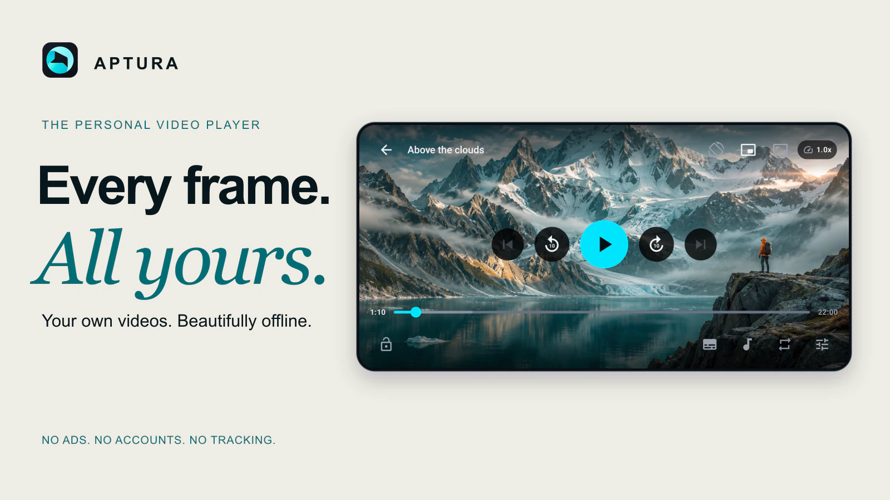
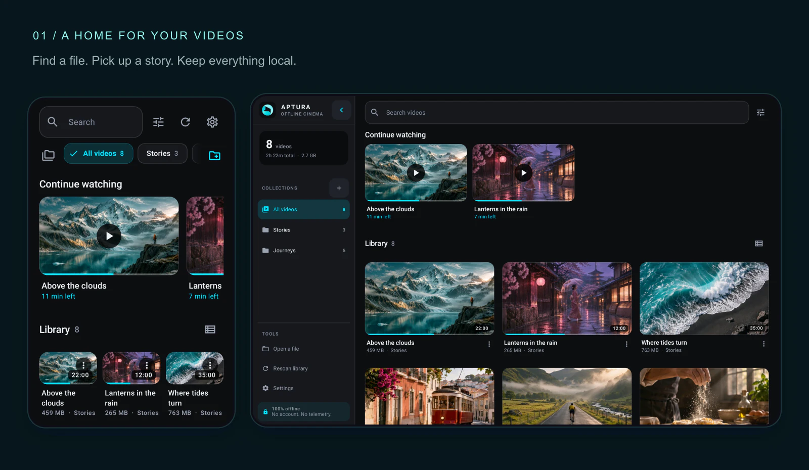
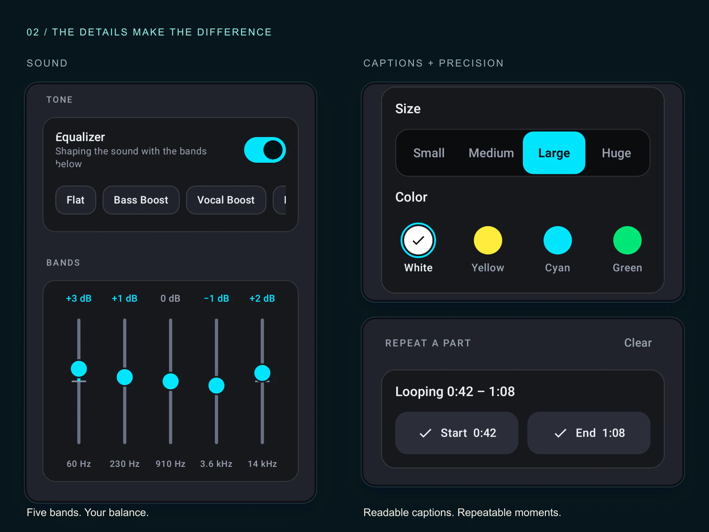

<picture>
  <source media="(max-width: 850px)" srcset="docs/assets/showcase/hero-mobile.webp">
  
</picture>

# Aptura

**An offline Android video player for the files you own.** A personal library, precise playback and room to make it yours. No ads, no account and no tracking.

[Build & install](#build--install) · [Explore the controls](docs/FEATURES.md) · [Privacy](docs/PRIVACY.md) · [Contribute](CONTRIBUTING.md)

[](https://github.com/TejuBoricha/Aptura/actions/workflows/ci.yml)
**Android 8.0+** · **Pre-release** · [Apache 2.0](LICENSE)

> [!NOTE]
> The 1.0 feature set is implemented; physical-device verification is still in progress. Build the current source to try it. The repository's “Latest” release contains FFmpeg support libraries, not an Aptura installer. See [release readiness](#release-readiness).

## A home for your videos

Find the clip you saved. Continue the story you paused. Bring a folder from an SD card into the same library.

Aptura indexes local videos with **MediaStore** and Android's **system folder picker**. Browse a grid or a list, search your files, organise a queue, and resume from saved progress. The layout adapts from a phone to a tablet; the library remains yours.

<picture>
  <source media="(max-width: 850px)" srcset="docs/assets/showcase/library-mobile.webp">
  
</picture>

[Inspect the phone library](docs/assets/showcase/native-library.webp) · [Inspect the tablet layout](docs/assets/showcase/native-tablet.webp)

## Small controls. A big difference.

A lesson worth slowing down. A line you want to hear again. Captions that need a little more room. Aptura puts the adjustments close to the picture.

- **Set your pace:** 0.25×–2.0× playback, hold for 2×, double-tap seek, and a sleep timer with a gentle fade.
- **Shape the sound:** audio tracks, a five-band equalizer, sound effects and precise audio sync.
- **Catch every word:** embedded or imported subtitles, timing adjustments, tap-to-sync, size, colour and background styling.
- **Keep the useful parts:** A–B repeat, frame stepping and named bookmarks.

<picture>
  <source media="(max-width: 850px)" srcset="docs/assets/showcase/controls-mobile.webp">
  
</picture>

[Explore every feature and the larger UI views](docs/FEATURES.md)

<details>
<summary><strong>More of the everyday details</strong></summary>

- Picture-in-Picture, background listening and audio-only playback.
- Brightness and volume gestures, swipe seeking and orientation lock.
- Fit/fill/zoom, picture adjustments, playback statistics and device-dependent decoder choice.
- Rename, copy, move, share and hide files. Where supported, Android's trash is the primary delete action.
- Six accent colours and system, light or dark appearance. The player and its sheets always stay dark.
- A local codec report, redacted diagnostics you can choose to share, and bundled open-source licence texts.

</details>

*The showcase combines real Compose UI renders and an Android player capture with illustrative demo media. [Capture provenance and presentation sources](docs/PRESENTATION.md).*

## Offline is built in

The app has no `android.permission.INTERNET`. Your library, preferences, progress and bookmarks stay on the device. There is no account service, advertising SDK, analytics SDK or automatic crash-report upload.

This boundary is checked in the **merged manifest, dependency graph and shipped release code**. Storage uses MediaStore and explicitly granted folder access; Aptura never requests all-files access.

External handoffs remain your choice: subtitle search opens your browser, and sharing opens Android's chooser. Local crash reports stay local until you export them. The [privacy policy](docs/PRIVACY.md) explains these paths.

## Build & install

Use **JDK 17** and **Android SDK Platform 37.0** (`platforms;android-37.0`). The app targets API 36 and runs on API 26 or newer. Gradle is supplied by the wrapper; first-build dependency and FFmpeg-bundle downloads require network access on the development machine.

```bash
git clone https://github.com/TejuBoricha/Aptura.git
cd Aptura
./gradlew assembleDebug
```

On Windows, run `.\gradlew.bat assembleDebug` in the cloned directory.

The universal debug APK is written to:

```text
app/build/outputs/apk/debug/app-universal-debug.apk
```

Install it on an authorised device with `adb install -r app/build/outputs/apk/debug/app-universal-debug.apk`, or use the matching ABI-specific APK. These are development builds. Signing, releases and troubleshooting are in the [build guide](docs/BUILDING.md).

## Built to keep its promises

**Kotlin + Jetpack Compose** provide the interface. **Media3** handles playback. **Room** indexes the library; **DataStore** keeps preferences. Domain contracts remain pure Kotlin, with Android services behind repository interfaces.

The local gate runs tests, lint and invariant guards. It builds and inspects release APK/AAB outputs when the change can affect them; CI runs the release checks on every pull request and exercises playback on an Android emulator.

```powershell
./tools/gate.ps1
```

[Architecture and data flow](docs/ARCHITECTURE.md) · [Testing and evidence](docs/TESTING.md) · [Live CI results](https://github.com/TejuBoricha/Aptura/actions/workflows/ci.yml)

## Release readiness

Aptura is in pre-release polish. **Bluetooth latency, TalkBack, HDR output and other physical-device checks remain open.** A single-device result is not universal hardware support. The [device checklist](docs/DEVICE_CHECKLIST.md) and [current audit](docs/audits/CURRENT_AUDIT.md) hold the detailed evidence and remaining work.

Video decoding depends on Android's available codecs; no software video decoder is bundled. The project's LGPL extension adds **ALAC, AC-3 and G.711 audio** when the device lacks those decoders. Other audio formats depend on the device. See [format support and limits](docs/FEATURES.md#formats-and-boundaries).

This is a player for local files. Network shares, casting, cloud sync and online catalogues are outside its scope. There is no iOS build.

## Find your way around

| If you want to… | Start here |
|---|---|
| Try a build or configure signing | [Building Aptura](docs/BUILDING.md) |
| Understand features and inspect the UI | [Feature guide](docs/FEATURES.md) |
| Follow the architecture | [Layers, storage and playback](docs/ARCHITECTURE.md) |
| Work on the interface | [Design system](DESIGN.md) · [Branding](docs/BRANDING.md) |
| Understand tests and release evidence | [Testing](docs/TESTING.md) · [Device checklist](docs/DEVICE_CHECKLIST.md) |
| See changes or remaining work | [Changelog](CHANGELOG.md) · [Current audit](docs/audits/CURRENT_AUDIT.md) |
| Update this presentation | [Presentation system](docs/PRESENTATION.md) |

## Make it better

Bug reports, translations, testing and focused patches all help. Read [CONTRIBUTING.md](CONTRIBUTING.md) before starting; keep the offline and storage boundaries intact, test behaviour changes, and run the gate. Agent-assisted work follows [AGENTS.md](AGENTS.md) and the [coordination workflow](docs/AGENT_WORKFLOW.md).

Report vulnerabilities through [SECURITY.md](SECURITY.md). Community participation follows the [Code of Conduct](CODE_OF_CONDUCT.md).

To support maintenance, [contribute on Ko-fi](https://ko-fi.com/tejuboricha), [donate through PayPal](https://paypal.me/tejuboricha), or share the project with someone who values a good local player.

## Open source, with attribution

Aptura is [Apache 2.0](LICENSE). Third-party notices are in [NOTICE](NOTICE) and inside the app. The audio-only FFmpeg libraries are separate LGPL-2.1 shared libraries; their exact source, build records and licence texts accompany the [pinned audio bundle](https://github.com/TejuBoricha/Aptura/releases/tag/ffmpeg-audio-n9.0.2-r2). See [the build guide](docs/BUILDING.md#the-ffmpeg-audio-libraries) for provenance and checksum verification.

Built with Android, Kotlin, Compose, Media3, Room, WorkManager, DataStore, Coil and FFmpeg. Thanks to the people who make these foundations possible.
