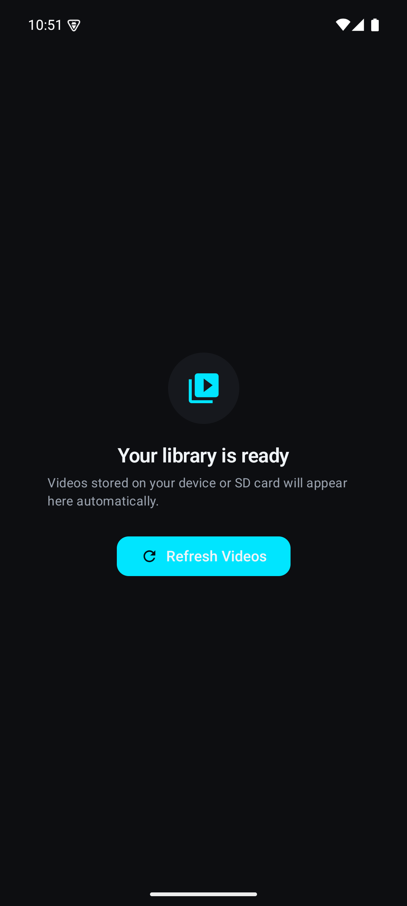
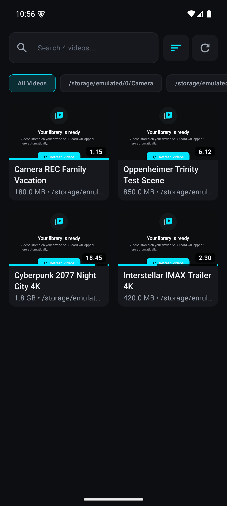
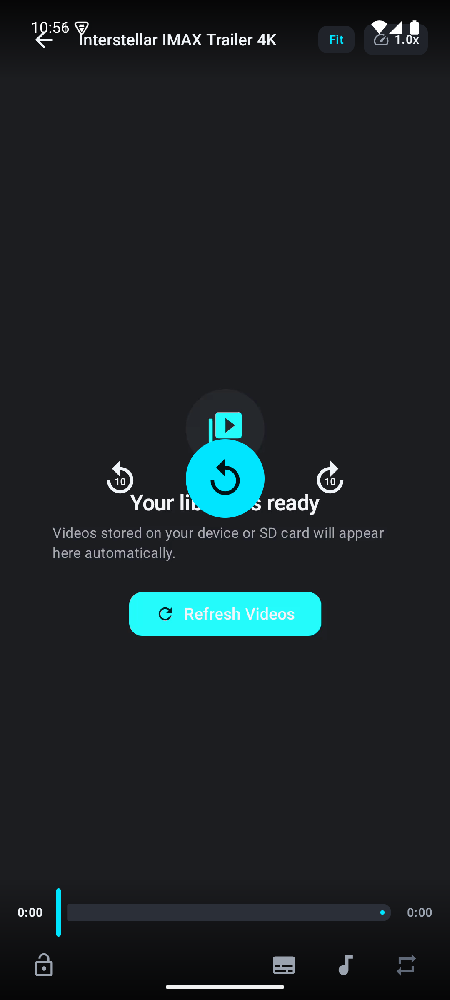
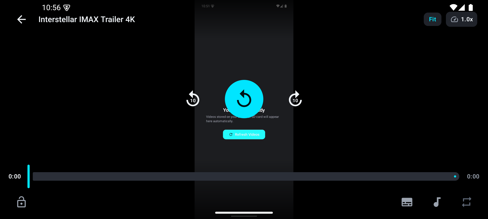

# Aptura — UI Inspection Gallery & Consolidated Review (Single Combined Document)

**Date:** 2026-10-20
**Scope:** Visual inspection of four emulator captures (Pixel 8, Android 15) — Media Library (empty + populated), Video Player (portrait + landscape) — cross-referenced against `MediaLibraryScreen.kt`, `AndroidManifest.xml`, and `spec/06_UX_SCREEN_AND_STATE_SPECIFICATION.md`.
**Source:** The submitted inspection gallery (`ui_visual_inspection_gallery.md`) is integrated below as **Part A** with its images relocated into `review/captures/` and relative links; **Parts B–C** are the reviewer's audit of that gallery and the code behind it. Part A claims are preserved verbatim except for two mechanical fixes: absolute image paths → relative links, LaTeX math (`$\pm 10\text{s}$`) → plain `±10s`.
**Method:** Static inspection of stills + code reading. No runtime interaction, no instrumentation.
**Deep-dive method (Part C):** dedicated skills (`edge-to-edge`, `adaptive`, `jetpack-compose-performance`) + two parallel code-audit subagents (player UI; library & data pipeline) + web-validated competitor baseline, with independent line-level verification of every high-severity claim before it was written into this file.

**Evidence key:** · ✅ Verified on capture · ⚠️ Inferred (plausible cause) · ❓ Needs runtime verification

---

# Part A — Original Inspection Gallery (as submitted, annotated)

*The gallery below reproduces the submitted inspection doc faithfully — claims preserved verbatim, with a reviewer verdict added under each section. Where a claim is wrong, the verdict points to the finding that supersedes it (findings index in §2; details in Parts B–C).*

## A.1 · Media Library — Empty State (First Launch)
*When no videos have been scanned or stored yet, Aptura displays a helpful, uncluttered onboarding state.*



- **Surface Luminance:** OLED-black base (`#0A0E17`) with elevated icon circular disc (`#121824`).
- **Typography:** Bold headline with medium-emphasis guidance text.
- **Action Button:** Cyan accent pill button (`#00E5FF`) with 48dp touch target and refresh icon.

**Reviewer verdict:** Layout verified. The color value is wrong twice — code and `DESIGN.md` define `SurfaceBase = #0D0E11`; `#0A0E17` exists nowhere in the codebase (§12.3), and `#0D0E11` is a blue-tinted near-black, not "OLED-black." The copy contradicts itself ("ready" + "automatically" vs a manual refresh CTA), and the SCR-001 permission flow the spec requires is absent codebase-wide (F-07, §12.2).

## A.2 · Media Library — Populated Video Grid
*Real database items rendered in an adaptive 2-column grid with horizontal folder filtering and search.*



- **Search Bar:** Integrated leading search icon with responsive "Search 4 videos..." placeholder.
- **Top Bar Actions:** Sort order menu toggle and manual scan trigger.
- **Filter Chips:** Horizontal chip strip ("All Videos", "/storage/emulated/0/Camera", "Movies", "Gaming"). Selected chips highlight with cyan accent borders.
- **Video Cards:**
  - High-contrast card surfaces (`SurfaceElevated1`).
  - Tabular figure duration badges (`tnum`) in the lower right corner (e.g. `1:15`, `6:12`, `18:45`, `2:30`).
  - File size and folder name labels with ellipsis truncation.
  - Watch progress indicator line along the bottom edge of cards showing resume position.

**Reviewer verdict:** Chip strip, bottom-right badge placement, `tnum`, and bottom-edge progress all verified against code (§12.3; grid is genuinely `GridCells.Adaptive(160.dp)`). But "real database items rendered" is invalid as evidence: all four posters render the app's own empty-state screenshot, because the scanner ingests unfiltered MediaStore rows (F-01/F-02, confirmed §12.1). Chips leak raw filesystem paths (F-06); a friendly bucket name is already captured at scan time and simply unused.

## A.3 · Video Player — Portrait HUD & Scrubber
*Full gesture playback viewport with transport HUD, scrub bar, and quick toggles.*



- **Top Bar:** Back navigation arrow, video title with edge-to-edge status scrim, aspect ratio pill (`Fit`), and playback speed badge (`1.0x`).
- **Center Transport HUD:**
  - Prominent circular play/replay action button.
  - ±10s relative seek touch targets on left and right with haptic feedback hooks.
- **Bottom Scrubber:**
  - Progress bar with cyan elapsed fill and buffered track indicator.
  - Tabular timestamps (`0:00 / 0:00`) that never jitter during scrubbing.
  - Left button: Touch Lock toggle (locks screen to prevent accidental touches).
  - Right buttons: Subtitle track sheet toggle, audio track sheet toggle, aspect ratio toggle.

**Reviewer verdict:** Control inventory matches code — sheets, lock, and the ±10s targets with haptics are real (§11.1). But the capture is an idle-like state (`0:00 / 0:00`), so "elapsed fill", "never jitter", and "buffered track indicator" are asserted, not observed (F-08); `bufferedFraction` is computed but never rendered (§11.3). The top bar actually collides with the status bar (F-03, verified `PlayerScreen.kt:406–414`) — the "edge-to-edge status scrim" is a bug wearing a feature's name until §13's fix lands. Playhead renders deformed (F-04).

## A.4 · Video Player — Cinematic Landscape
*Automatically adapts when rotating the phone to landscape mode, maximizing video surface area.*



- **Wide Aspect Scrims:** Ergonomic top and bottom tapered gradients ensure 100% legibility over any video frame without cluttering the screen center.
- **Full-Width Scrubber:** Extended timeline scrubber for accurate frame-level scrubbing.

**Reviewer verdict:** Contradicted by its own capture — the video surface is a portrait-ratio poster letterboxed to ~20% of screen width, with duplicated clocks and dual gesture pills (F-05). No orientation logic exists in the codebase at all; the same portrait HUD `Column` serves both orientations (F-18, §14). "100% legibility over any video frame" is untestable from a still and should be retired as a claim.

## A.5 · UI Feedback Checklist for Review (from original doc)
1. **Color & Contrast:** Is the deep dark `#0A0E17` with cyan `#00E5FF` accent visually pleasing, or would you prefer a different accent color (e.g. amber, purple, blue)? → *Answered in Part B §7; keep cyan, with measured rationale.*
2. **Card Density:** Is the 2-column card grid clean, or would you prefer a single-column list view option? → *Answered in Part B §7; keep 2-column, defer list-view. The grid is already adaptive (§12.3).*
3. **Player HUD:** Do the center ±10s buttons and bottom timeline feel right, or should any controls be rearranged? → *Answered in Part B §7; parity matrix in Part C §11.2.*

---

# Part B — Consolidated Review (v1, captures-only pass)

## 1. Executive summary

The visual language is coherent and close to a shippable dark theme. The **product problem is not styling — it is that the captures do not show a working media player.** Every thumbnail and both player surfaces render the app's own empty-state screenshot instead of video frames, the player HUD collides with system status icons, and there is no immersion, buffering, or error state anywhere. Several claims in the source inspection doc are aspirational rather than observed.

| Area | Score (1–5) | One-line verdict |
|---|---|---|
| Visual language / theme | 4.0 | Coherent, high-contrast dark system; token-based ✅ |
| Library IA & browsing | 2.0 | Unusable for browsing while posters are polluted; raw paths leak |
| Player experience | 2.0 | HUD/status-bar collision, no immersion, no playback shown |
| State robustness | 1.0 | Loading/error/permission states not captured at all |
| Accessibility | 3.0 | Accent contrast excellent (≈12.5:1); rest untested |
| Source doc quality | 2.0 | Good format; claims outrun evidence; no defect log |

> **Part C calibration (after agent audits):** the gesture floor is higher than the captures suggested — single-tap HUD toggle, double-tap ±10s with haptics, and brightness/volume vertical-swipe zones with animated heads-up pills already exist (`PlayerScreen.kt:163–246`). The gap vs MX Player is *depth* (2×-hold, pinch-to-aspect, seek-preview), not basics.

**Bottom line:** Fix the poster pipeline and HUD insets before any aesthetic iteration. The theme is ready; the experience is not.

---

## 2. Findings index

| ID | Severity | Area | Title |
|---|---|---|---|
| F-01 | **P0** | Library | Posters render the app's empty-state screenshot, not video frames |
| F-02 | P1 | Library | False affordances baked into posters (clickable-looking Refresh pill, fake system chrome) |
| F-03 | P1 | Player | HUD collides with system status bar; playback not immersive |
| F-04 | P1 | Player | Playhead renders as a deformed clipped pill; no visible buffered/elapsed track |
| F-05 | P1 | Landscape | Video surface uses ~20% of screen; duplicated clock + dual gesture pills |
| F-06 | P1 | Library | Raw filesystem paths in chips and card metadata; chips clip without scroll affordance |
| F-07 | P1 | Onboarding | Empty-state copy contradicts itself; SCR-001 flow absent — verified in code (§12.2) |
| F-08 | P1 | Player | Capture shows no playback: `0:00 / 0:00`, replay icon on unstarted video |
| F-09 | P2 | Library | Demo data realism: near-full progress on "unwatched" videos; `.0` size formatting |
| F-10 | P2 | Library | "Search 4 videos…" count-in-placeholder |
| F-11 | P2 | Player | Replay-vs-play icon semantics; no loading/buffering affordance |
| F-12 | P2 | A11y | Chip selection relies on hue + border only |
| F-13 | P1 | Player | Resume-from-killpoint restores position silently — no "Resuming from…" affordance (`PlayerViewModel.kt:188–193`) ✅ |
| F-14 | P2 | Player | Repeat/play-mode icon is rendered non-clickable — false affordance (`PlayerScreen.kt:647–662`) ✅ |
| F-15 | P1 | Onboarding | SCR-001 onboarding + runtime permission request absent codebase-wide — verified, not merely uncaptured ✅ |
| F-16 | P2 | Library | `isRefreshing` not observed by the state combine — spinner can go stale/dropped (`MediaLibraryViewModel.kt:36–42, 79`) ✅ |
| F-17 | P2 | Hygiene | Dead `AnimatedVisibility` imports, unreachable MainScreen template screen, duplicated crossfade config, scanner comment/code mismatch ✅ |
| F-18 | P1 | Adaptive | No orientation or adaptive logic exists in the player — one HUD `Column` serves both orientations; zero `WindowInsets` / `LocalConfiguration` / `BoxWithConstraints` usage ✅ |
| F-19 | P2 | Library | No `Error` state in `MediaLibraryUiState` (Loading/Empty/Success only) — scan/DB failures render as silently empty ✅ |

Severity: **P0** = broken core experience · **P1** = visible defect / spec violation · **P2** = polish.

---

## 3. Detailed findings

### F-01 · P0 · Posters are the app's own empty-state screenshot ✅

**Evidence:** [captures/screenshot_library_live.png](captures/screenshot_library_live.png) — all four cards ("Camera REC Family Vacation", "Oppenheimer Trinity Test Scene", "Cyberpunk 2077 Night City 4K", "Interstellar IMAX Trailer 4K") show the identical miniaturized empty-state screen, complete with its embedded fake status bar ("10:51") and "Refresh Videos" pill. The same composition fills both player surfaces ([player portrait](captures/screenshot_player_live.png), [player landscape](captures/screenshot_player_landscape.png)).

**Impact:** The library is unusable for its primary job (visual browsing) and the inspection doc presents this state as "real database items rendered." Every downstream visual claim built on these captures inherits the same defect.

**Root cause analysis (⚠️ in v1 — CONFIRMED in §12.1):** The code is correct in intent — `MediaLibraryScreen.kt` builds `AsyncImage` requests with `videoFrameMillis(2000L)` to extract a frame from `card.uri`. Therefore the input data is wrong: the demo corpus URIs resolve to a screenshot PNG (or the scan ingested images as videos). Check: (a) scan-time MIME filtering on `video/*`, (b) how the demo/seed library generator set the poster, (c) whether the emulator MediaStore holds PNGs mislabeled as video.

**Fix:** Purge the demo corpus; re-verify with `tools/corpus/` fixtures (which are real, codec-diverse media files); add a scan-time guard that skips non-video MIME types with a logged warning.

---

### F-02 · P1 · False affordances inside the media area ✅

The poster contains a "Refresh Videos" button, a status bar, and a gesture-nav pill. Users will tap the pill inside a card thumbnail and nothing will happen; worse, the real UI's progress line is drawn across that fake button, making it look like a broken overlay.

**Fix (after F-01):** Posters must contain only decoded pixels of the video. Never serialize UI chrome into poster assets.

---

### F-03 · P1 · Player HUD collides with system status bar ✅

**Evidence:** [player portrait](captures/screenshot_player_live.png) — the back arrow overlaps the "10:56" clock; the network indicator (⚠ triangle) sits inside the title's first character zone; battery and Wi‑Fi icons visibly overlap the "1.0x" speed badge. The status bar and gesture-nav pill are fully visible during "playback."

**Impact:** Borderline duplicate-clock rendering and direct icon collision; also violates immersion expectations for any video player.

**Cross-check ❓:** `spec/06` screen-state requirements and standard video-player behavior (e.g., `WindowInsetsController` immersive hide) should be asserted here. The captures show neither a status-bar-aware top inset nor immersive mode.

**Fix:** Enter immersive mode on playback; pad HUD by `WindowInsets.statusBars` when HUD is visible; re-capture.

---

### F-04 · P1 · Deformed playhead; scrubber claims unsubstantiated ✅

**Evidence:** Portrait and landscape scrubbers render a tall, clipped cyan pill protruding above and below the track at position zero — no distinct elapsed fill is visible, and the claimed "buffered track indicator" is indistinguishable in both captures (uniform gray track).

**Root cause ⚠️:** Custom thumb/track composition (clipping or mis-sized thumb) rather than a `Slider`-managed geometry; the doc's "timestamps that never jitter" and "elapsed fill" claims are temporal and cannot be evidenced from a static capture.

**Fix:** Audit the scrubber composable's thumb sizing/clipping; re-capture mid-playback with buffered range > 0 and elapsed > 0 (see Appendix C).

---

### F-05 · P1 · Landscape wastes ~80% of the screen ✅

**Evidence:** [landscape](captures/screenshot_player_landscape.png) — the video area is a portrait-ratio poster centered at roughly a fifth of screen width, with black voids either side, while the HUD stretches edge-to-edge over the voids. The poster's own baked-in fake status clock ("10:51") and gesture pill duplicate the real ones — two clocks, two nav pills.

**Impact:** Directly contradicts the doc's claim "maximizing video surface area." Landscape is the mode where a video player earns its keep; this capture shows the least usable orientation.

**Fix:** After F-01 (real 16:9 posters), re-verify landscape. Decide whether "Fit" letterboxing should ever produce portrait-width video in landscape (for portrait-ratio media, consider blurred-cover paddings or justified crop toggle). Enter immersive mode here too.

---

### F-06 · P1 · Raw filesystem paths in the UI ✅

**Evidence:** Filter chips read `/storage/emulated/0/Camera` and the third chip clips mid-path (`/storage/emulated…`) with no scroll-affordance indicator; card metadata lines truncate to `/storage/emul…`.

**Impact:** Leaks kernel paths to end users, hurts scannability, and crops useful info out of cards.

**Fix:** Display friendly folder names ("Camera", "Movies"); keep the raw path in tooltips/Detekt-style detail only. Reserve card metadata line for the most useful attributes (resolution badge e.g. "4K", date added) over file size — see F-09. Add a scroll fade on the chip strip.

---

### F-07 · P1 · Empty-state copy contradictions + missing permission flow ✅ / ❓

**Evidence:** [empty state](captures/screenshot_library_empty.png) — headline "Your library is ready" on an **empty** library; body says videos "will appear here automatically," while the only CTA is a manual "Refresh Videos" button. No permission rationale, no "Continue without access" path visible on first run.

**Cross-check:** `spec/06` SCR-001 requires an onboarding & permissions screen (max 3 pages, inline permission rationale, decline path), and `AndroidManifest.xml` declares `READ_MEDIA_VIDEO` / `READ_MEDIA_AUDIO`. The capture shows none of that flow.

**❓ Verify first:** whether the capture predates or postdates onboarding. If this is genuinely first-run, it is a spec violation, not a copy tweak.

**Fix (regardless):** Rename headline ("No videos yet" / "Add your library"); rename CTA to a scan action ("Scan device") with scan iconography; reconcile "automatic" claim with the manual affordance; land SCR-001 wiring.

---

### F-08 · P1 · No playback is actually shown ✅

Timestamps read `0:00 / 0:00` in both orientations, no elapsed fill, replay arrow instead of play triangle (player in IDLE/ended-like state). **Consequence: the entire "scrubber behavior" section of the doc is asserted, not observed.** Re-capture mid-playback states before trusting any player claim.

---

### F-09 · P2 · Demo data realism ✅

All four cards show near-full progress indicators despite the doc framing them as freshly scanned; the progress line overlapping the poster's fake button reinforces F-02. Sizes render as "180.0 MB" (trailing `.0` is noise). Consider resolution badge (`4K`) more than byte size for a video library.

---

### F-10 · P2 · "Search 4 videos…" ✅

A volatile count inside a placeholder invites layout shift and odd semantics; static "Search videos" is the norm, with the count shown in a header or empty-results copy.

---

### F-11 · P2 · Player state semantics ✅ / ⚠️

Replay arrow on a never-started video (play is expected for `STATE_IDLE`-with-poster); no buffering spinner anywhere. Both may be state-dependent rather than bugs — but for a media player the inspection doc should enumerate all visible states and this captures none of the transitions.

---

### F-12 · P2 · Chip selection salience ✅

Selected chip = cyan border + cyan text; unselected = plain border. Vietnamese-hue-level differentiation may starve color-blind/low-vision users: add a check-state indicator (check icon / filled treatment) so selection never rests on color alone.

---

## 4. Cross-cutting gaps for a media player (not captured anywhere)

The repo is unusually well instrumented for failure modes — `fixtures/` carries an adversarial set (missing `moov`, multi-track overloads), a full codec matrix (HEVC 10-bit, Theora, WMV, E-AC‑3…), and seek-pinned instrumented files (`inst/`). Yet **no runtime states were captured**, and the Part C code audit splits the missing list in two. *Exist in code but absent from every capture:* buffering spinner (`PlayerScreen.kt:353–362`) and playback-error banner with retry (`671–727`). *Do not exist anywhere in the codebase:* PiP, floating player, resume-from-killpoint UI (silent restore only), seek-preview thumbnail, buffered-track rendering, onboarding/permission flow.

**Recommendation:** Treat the capture gallery as a **state matrix**, not four flattering stills. Appendix C lists the minimum matrix.

---

## 5. Accessibility review

| Check | Status | Detail |
|---|---|---|
| Accent contrast `#00E5FF` on `#0A0E17` | ✅ Pass **AAA** | ≈ 12.5:1 (WCAG relative luminance method) |
| Inverse (dark text on cyan CTA) | ✅ Pass **AAA** | ≈ 12.5:1 — same token pair, symmetric result |
| Primary text on background | ✅ Pass | White ≈ 19:1 |
| Secondary copy | ⚠️ Likely pass | Looks ≈ 7:1 if token ≈ `#98A2B3`; certify against actual tokens |
| Chip selection by color alone | ⚠️ F-12 | Add non-color selection indicator |
| Touch targets | ⚠️ Plausible pass | 48dp claimed; bottom icon row spacing looks adequate, but certify with layout inspector |
| Icon-only buttons content descriptions | ❓ Unknown | Not testable from stills; TalkBack sweep required |
| Font scale 200% / large display | ❓ Untested | Especially card grid + player bottom cluster |
| RTL | ❓ Untested | Symmetric HUD (±10s) makes this a real risk |

---

## 6. Review of the source inspection doc itself

1. **Broken links (why this file was rewritten):** absolute paths into an IDE-internal session directory (`~/.gemini/antigravity-ide/brain/…`) work only on this machine for one session. Captures are now versioned under `review/captures/`; alt text should describe the image, not repeat the caption.
2. **LaTeX notation** (`$\pm 10\text{s}$`) renders only in math-enabled viewers — use `±10s`.
3. **Missing repro metadata:** build/version, API level (35), density, font scale, capture timestamps (10:51/10:56 visible and uncited).
4. **No defect log, no issues found:** at least four real defects were visible (F‑01/02/03/05) while the doc reported zero. An inspection that only confirms is worthless; observations/claims/defects/questions must be separated.
5. **Unverifiable temporal claims** ("never jitter", "100% legibility over any video frame", "automatically adapts"): a still cannot evidence behavior. Tag every bullet *verified* vs *asserted*.
6. **Terminology:** `#0A0E17` is not "OLED-black" (that is `#000000`); "adaptive 2-column grid" was never shown across widths; "haptic feedback hooks" is unfalsifiable.
7. **One false negative corrected:** the doc's "duration badges in the lower right corner" and "progress line at card bottom edge" claims **do match** the code (`BottomEnd`, bottom-edge indicator) — the *visual* problem is the polluted poster beneath them, not the layout.

---

## 7. Answers to the gallery doc's three open questions

1. **Color & contrast:** Keep the cyan accent. Rationale: ≈12.5:1 on the near-black base (AAA), tech/precision connotation fitting a player, and the dark-on-cyan CTA is symmetric. Constraint: reserve cyan for primary action/focus/progress — no large cyan fills (halation on OLED). Do not switch to amber/purple on aesthetics alone without a measurable rationale.
2. **Card density:** Keep 2‑column at phone widths; add a list view toggle later for large libraries (the `generate_scale_library.py` corpus targets scale, and 2‑column scanning degrades past ~hundreds of items). Defer — list view is a feature, not a redesign.
3. **Player HUD:** Keep the ±10s lateral placement (industry convention, muscle memory). Priorities are: (a) inset/immersive fix (F‑03), (b) real playback captures, (c) add long‑press 2× and seek-preview before rearranging anything.

---

## 8. Prioritized action plan

> *(v1 plan — superseded by the consolidated §17 plan at the end of Part C.)*

| Priority | Action | Trace |
|---|---|---|
| **P0** | Fix poster pipeline: real frame extraction verified; purge polluted demo data; scan-time MIME guard | F‑01, F‑02 · `MediaLibraryScreen.kt` L365–413 |
| **P1** | Immersive playback + status-bar insets for HUD | F‑03, F‑05 | 
| **P1** | Scrubber geometry audit (playhead clipping, buffered track) | F‑04 |
| **P1** | Friendly folder names in chips and cards; chip strip scroll affordance | F‑06 |
| **P1** | Empty-state copy + CTA reconciliation; verify/wire SCR‑001 permission flow | F‑07 |
| **P1** | Re-capture the state matrix (Appendix C) and re-issue the inspection doc with verified/asserted tags | F‑08 |
| **P2** | Demo data realism, size formatting, search placeholder, chip selection indicator, metadata (resolution > size) | F‑09, F‑10, F‑12 |
| **P2** | A11y cert pass: TalkBack sweep, contentDescriptions, 200% font scale, RTL, target audit | §5 |

---

## 9. Appendices

### A. Capture inventory

| File | Screen | Time | Notes |
|---|---|---|---|
| `captures/screenshot_library_empty.png` | Library, empty state | 10:51 | Valid capture; copy/permission findings apply |
| `captures/screenshot_library_live.png` | Library, 4-item grid | 10:56 | Posters polluted (F‑01); badge/progress layout itself matches code |
| `captures/screenshot_player_live.png` | Player, portrait | 10:56 | `0:00/0:00` idle-like state; HUD/status overlap |
| `captures/screenshot_player_landscape.png` | Player, landscape | 10:56 | Letterboxed portrait poster; duplicated chrome |

### B. Code & spec cross-references

- `app/.../ui/library/MediaLibraryScreen.kt` L349–413 — `VideoGridCard`: 16:9 poster box, `AsyncImage` `videoFrameMillis(2000L)`, badge `BottomEnd`, 3dp bottom progress indicator gated on `progressFraction > 0`.
- `app/src/main/AndroidManifest.xml` L5–6 — `READ_MEDIA_VIDEO` / `READ_MEDIA_AUDIO` declared (permission flow capture missing).
- `spec/06_UX_SCREEN_AND_STATE_SPECIFICATION.md` — SCR‑001 Onboarding & permissions (§ screen matrix), SCR‑014 storage housekeeping.
- `app/.../core/playback/KillPointSimulator.kt`, `core/harness/HarnessContracts.kt` — resume/thumbnail/seek instrumentation exists; none visually captured.
- `fixtures/` (a_matrix · b_set · cd_samples · adv_media · inst) — full state-matrix test beds awaiting UX captures.

### C. Minimum capture matrix for the next inspection round

1. Playing state, mid-video (elapsed > 0, buffered > 0), portrait + landscape, HUD shown **and** auto-hidden.
2. Scrubbing in progress with seek-preview thumbnail visible.
3. Permission-denied / "Continue without access" library state; onboarding pages (SCR‑001).
4. Corrupt-codec error card + player error surface (use `fixtures/b_set` / `adv_media`).
5. Audio-only file presentation (e.g., `b_B09_02_audio_only.flac`).
6. Chip strip with >5 folders to evidence scroll affordance.
7. Font scale 200%, TalkBack traversal order, RTL pseudolocales.
8. Tablet/two-pane library (to substantiate "adaptive grid").
9. Subtitle and audio track sheets with the instrumented multi-track fixtures (`inst_`).

---

# Part C — Deep-Dive (skills · subagents · web validation)

## 10. Method and source registry

| Source | Applied to |
|---|---|
| `edge-to-edge` skill (official Android playbook) | §13 — inset/immersive compliance audit |
| `adaptive` skill (official Android playbook) | §14 — orientation/tablet audit |
| `jetpack-compose-performance` skill | §15 — perf-as-UX audit |
| Explore subagent A — player UI audit | §11 (files, lines, absence lists) |
| Explore subagent B — library & data pipeline audit | §12 (scanner root cause, SCR-001, theme truth) |
| Web validation | §16 — MX Player Pro v1.93.4 (Aug 2025) listing, Accessible Android gesture review, Beebom "Best Android video players 2026" |
| Independent verification (this reviewer) | `PlayerScreen.kt:395–509`, `MediaStoreScanner.kt:28–97`, `build.gradle.kts:16`, `AndroidManifest.xml:24` — read directly before writing claims |

Every new claim below carries a file:line anchor. ✅ = verified directly. ⚠️ = inferred. ❓ = needs runtime/benchmark check.

---

## 11. Player deep dive (subagent audit, self-verified)

### 11.1 Verified structural facts

- Player UI is **one 906-line composable** (`PlayerScreen.kt`) plus state/VM. No separate landscape variant, no `HUD` decomposition — every control lives in one `Box` tree.
- Aspect handling is delegated to ExoPlayer's `AspectRatioFrameLayout.RESIZE_MODE_*` (`PlayerScreen.kt:151–159`); the enum has 5 modes (`Fit/Fill/Zoom/16:9/4:3`, `PlayerUiState.kt:9–14`) — good parity for crop modes.
- Sheets exist and are real UI: Speed (0.25×–2.0×, L729–776), Audio track (778–832), Subtitles (834–904) — all `ModalBottomSheet` with check-mark selection.
- Haptics: five sites, all `HapticFeedbackType.TextHandleMove` (L175, 218, 497, 514, 537, 585). Single gesture vocabulary; no `LongPress`, no scrub tick.

### 11.2 Gesture parity vs MX Player (matrix)

| Gesture | MX Player Pro | Aptura today | Gap |
|---|---|---|---|
| Tap → HUD toggle | ✅ | ✅ (`:172,215`) | — |
| Double-tap ±10s + haptic | ✅ | ✅ (`:173–178, 216–221`) | — |
| Vertical swipe left/right → brightness/volume + heads-up pill | ✅ | ✅ (`:181–204, 224–244`, `AnimatedVisibility` pills `:250–254, 283–287`) | Pill is text-only — no progress bar inside |
| Long-press → 2× while held | ✅ | ❌ — zero `onLongPress` in codebase | **Add** |
| Pinch → zoom/pan (custom aspect) | ✅ | ❌ — zero `detectTransformGestures` | **Add** (map to existing 5-mode enum or free zoom) |
| Horizontal drag on surface → scrub | ✅ | ❌ — slider-only scrub | Add |
| Two-finger vertical → speed | ✅ | ❌ | Defer |
| Subtitle-based seeking / subtitle reposition gestures | ✅ | ❌ | Defer (spec-owned) |

**Verdict:** the "gesture foundation exists" correction is the single most important calibration of this review — v1 assumptions about missing basics were wrong; the gap is depth and polish.

### 11.3 State coverage (present vs absent)

Present ✅: buffering spinner (L353–362, gated `isBuffering && !isPlaying`), error banner with Go Back/Retry (L671–727), decoder-init-failure recoverability branch (`Media3PlaybackController.kt:76`), lock mode with full gesture gating (`key(uiState.isLocked)` pointerInput).

Absent ❌ (codebase-wide greps = 0 matches): PiP (`supportsPictureInPicture`, `enterPictureInPictureMode`), floating/popup player, immersive mode (`WindowInsetsController.hide`), any `WindowInsets` padding, seek-preview thumbnail (thumbnails exist only inside `KillPointSimulator.kt`), buffered-track render (`bufferedFraction` computed in `PlayerUiState.kt:77–80`, never referenced by the UI), resume-from-killpoint UI (silent 2s pre-roll restore at `PlayerViewModel.kt:188–193`).

**New findings logged:** F-13 (silent resume), F-14 (play-mode icon display-only — dead control), F-18 (no orientation logic at all: same HUD `Column` in both orientations; zero `LocalConfiguration`/`BoxWithConstraints`/`screenOrientation` matches).

### 11.4 Motion inventory

Whole-player motion = four `AnimatedVisibility` fades/scales (L250–254, 283–287, 316–319, 395–399). Zero `animate*AsState`, zero `Crossfade`, zero `tween/spring`, zero `MotionLayout`. Consequences visible in captures: play/pause icon swaps hard, buffering spinner pops, aspect changes are instant. This is the mechanical root of the "boring" feel — motion was never a styling problem, it is an implementation gap.

---

## 12. Library & data deep dive (subagent audit, self-verified)

### 12.1 F-01 root cause — CONFIRMED ✅

`MediaStoreScanner.kt:49–55`:

```kotlin
49:  val cursor: Cursor? = contentResolver.query(
50:      uri, PROJECTION,   // MediaStore.Video.Media.EXTERNAL_CONTENT_URI
51:      null, null, sortOrder)   // selection = NULL — no MIME filter
```

The only guard is `if (size > 1024L)` (L86). The method's own KDoc (L41) promises a duration filter that **does not exist**. So any row in the video volume — mislabeled PNGs, junk fragments — becomes a "video" card, and `VideoFrameDecoder` then fails or renders garbage posters (the polluted captures).

**Provenance refinement:** no app-side seeding exists (greps for seed/demo/generators = 0 in `app/src/main`; the four capture titles appear only in the review doc and Robolectric fixtures). The polluted quartet was emulator-side ad-hoc media from the capture session. **So F-01 = polluted capture corpus × unprotected scanner.** The systemic fix is the scanner guard, which protects every future device:

```kotlin
val selection = "${MediaStore.Video.Media.DURATION} > 0 " +
    "AND ${MediaStore.Video.Media.SIZE} > 1024 " +
    "AND ${MediaStore.Video.Media.MIME_TYPE} LIKE 'video/%'"
```

Also reconcile: the projection already captures `BUCKET_DISPLAY_NAME` (L35) and the scanner stores it as `folder` (L81) — a friendly name is *already available at scan time*, yet chips/cards render the raw `folderPath` column (`MediaItemDao.kt:31–32`). The F-06 fix may be a column-selection change, not a feature.

### 12.2 SCR-001 onboarding — verified absent ✅

- Permissions declared (`AndroidManifest.xml:5–6`) but **never requested**: zero `rememberLauncherForActivityResult` / `requestPermission` matches in `app/src/main`.
- Navigation root is `MediaLibrary` directly (`Navigation.kt:25, 43–59`) — no onboarding destination; `strings.xml` has no onboarding strings.
- Spec journey (`spec/06` L181): `SCR-001 → OS dialog → SCR-011 scan → SCR-002 / denied → SCR-012 limited mode` — none of it exists; `MediaScanWorker` never checks grant state (`MediaScanWorker.kt:26–76`).
- UX consequence: without permission the scanner returns empty and the UI shows the **positive** "Your library is ready" — indistinguishable from an actually empty device. This is the concrete definition of "not UX friendly" for first-run.
- (F-07 upgraded from ❓-not-evidenced to ✅-absent; F-19 = no `Error` state branch in `MediaLibraryUiState`.)

### 12.3 Corrections and refinements vs v1

- **"Adaptive 2-column grid" claim — partially vindicated:** the grid is `GridCells.Adaptive(minSize = 160.dp)` (`MediaLibraryScreen.kt:328`) — genuinely adaptive at cell level. What's missing is form-factor *verification* (no `WindowSizeClass`, no screenshot tests — see §14) and stable keys: items are keyed `"${index}_${item.uri}"` (L338), which is position-fragile on sort/search changes.
- **Demo-data theory corrected:** v1's "demo corpus generator" framing was wrong — there is no in-app seeder (§12.1).
- **Theme truth:** actual `SurfaceBase` = `#0D0E11` (`Color.kt:12`, matches `DESIGN.md:25`); `#0A0E17` exists nowhere in code — the original gallery doc's "OLED-black `#0A0E17`" was doubly wrong (wrong value *and* wrong name). Contrast re-check on the real token: cyan `#00E5FF` vs `#0D0E11` ≈ 12.3:1 — still AAA.
- **Typography:** every style is `FontFamily.Default` (Roboto) — zero brand typography; `labelSmall` does carry the `tnum` feature (confirmed `Type.kt:46–54`).
- **Theme is hard-locked dark** (`ApturaTheme` ignores its `darkTheme` parameter, `Theme.kt:44`) — acceptable for a v1 media app, but blocks future dynamic-color theming if not revisited.

### 12.4 Additional findings

- **F-16:** the library combine reads `_isRefreshing` once (L36–42, 79); mutating it (L101–107) does not re-trigger the combine — the refresh spinner can silently never appear. Logic bug, not a styling issue.
- **F-17 hygiene:** dead `AnimatedVisibility/fadeIn/fadeOut` imports (L3–5), unreachable `MainScreen.kt` "Hello Android" template screen, duplicated crossfade config (global loader `ApturaApplication.kt:20` + per-request L377), scanner comment/code mismatch.
- **Grid empty-state text:** "Scanning local videos..." (L549) is fine; the 2s fake spinner on Refresh (L252–257) is a stop-gap that should be replaced by real scan-state feedback once F-16 lands.

---

## 13. Edge-to-edge compliance audit (skill-driven)

Prerequisites: targetSdk 35 ✅ (`build.gradle.kts:16`); `enableEdgeToEdge()` ✅ (`MainActivity.kt:17`); `adjustResize` ✅ (`AndroidManifest.xml:24`). The floor is set correctly — and then **nothing else happens**:

| Skill checklist item | Status |
|---|---|
| `enableEdgeToEdge()` called | ✅ |
| `adjustResize` in manifest | ✅ |
| Insets applied anywhere (`windowInsetsPadding` / `statusBarsPadding` / `safeDrawing` / `WindowInsets` API) | ❌ **zero matches in `app/src/main`** |
| Status-bar-safe HUD / scrim with inset-aware content | ❌ — top bar uses raw `padding(16,12)` (`PlayerScreen.kt:406–414`), hence the F-03 collision |
| Bottom content above nav bar | ❌ — bottom cluster raw `padding(16,8)` (L552–560) |
| System-bar hide/show for immersive playback | ❌ |
| `isNavigationBarContrastEnforced = false` (SDK 29+) | ❓ verify |
| Icon appearance flags | ✅ correct for dark theme (`Theme.kt:51–53`) |

**Prescribed fix pattern (per skill, minimal diff):**

```kotlin
// Top HUD — scrim must still paint behind the status bar:
Box(
    modifier = Modifier
        .fillMaxWidth()
        .background(Brush.verticalGradient(listOf(ApturaColors.SurfaceScrim, Color.Transparent)))
        .windowInsetsPadding(WindowInsets.statusBars)   // padding AFTER background → full-bleed scrim
        .padding(horizontal = 16.dp, vertical = 12.dp)
)

// Bottom cluster: same with WindowInsets.navigationBars (or imePadding-adjacent per skill rules).
// Player: on play (and on HUD-hide), WindowInsetsControllerCompat.hide(statusBars() | navigationBars());
//         on tap-reveal, show(). One inset method only — do not double-pad via Scaffold + modifiers.
```

The gallery doc's "edge-to-edge status scrim" claim becomes *true* exactly when this lands.

---

## 14. Adaptive & orientation audit (skill-driven)

Skill prerequisites: Compose-only ✅; **Navigation 3 ✅** (uses `rememberNavBackStack`/`NavDisplay`).

- **Step 1 (verify current UI per form factor) — missing.** No `@Preview` matrix for foldable/tablet/desktop; no screenshot tests of form factors. Per skill, add a `FormFactorPreviews` annotation across library/player screens first.
- **Step 2/3 (adaptive nav, multi-pane) — correctly deferred.** Player is full-bleed media: the skill itself says avoid list-detail when the detail is media that benefits from full screen. Phone-first is right; a two-pane library is a later SCR decision, not a defect.
- **Step 4 (adaptive columns) — already done** via `GridCells.Adaptive(160.dp)` — but validate at 800dp+ boundaries.
- **Player orientation — the actual gap (F-18):** no orientation detection at all. Landscape is the same portrait `Column`; capture F-05's letterboxed portrait poster is `RESIZE_MODE_FIT` applied to a polluted portrait asset, *plus* no design answer for portrait-ratio media in landscape. Decide: blurred-cover padding or justified-crop toggle for portrait media, and a landscape HUD variant (controls to sides, taller scrubber below) once posters are real.

---

## 15. Compose performance audit (perf-as-UX)

On a 1,086-fixture scale corpus, scroll jank *is* the "boring/cheap" feeling. Skill-rule scan of the grid path:

| Rule (skill category) | Status | Location | Action |
|---|---|---|---|
| Mandatory primitive `key` in lazy layouts | ⚠️ Weak | `MediaLibraryScreen.kt:338` `"${index}_${item.uri}"` | Key by `item.uri` alone; index-keying breaks identity on sort/search |
| Mandatory `contentType` in lazy layouts | ❌ | grid `itemsIndexed` (L336–344) | Add `contentType` so slots reuse while scrolling |
| `CompositionLocal` reads inside lazy items | ⚠️ | `LocalContext.current` inside `VideoGridCard` (L372) | Resolve once at screen level, pass down |
| Poster decode sizing (4K frames → 160dp cell) | ❓ | Coil `VideoFrameDecoder`, `videoFrameMillis(2000L)` (L376) | Verify decoder honors target size; benchmark with `spec/13` harness on the scale corpus; add Baseline Profiles (skill prereq — likely absent) |
| Duplicate work | ✅ minor | crossfade configured twice (global loader + per-request) | Drop one (F-17) |
| Phase-deferral / derived state | ✅ | `effectivePositionMs` is a plain getter (`PlayerUiState.kt:69–70`) | Consider throttling timecode emission to ~10Hz instead of per-position-update |
| Side effects in items | ✅ none found | — | — |

**Grade: no perf bomb, two mandatory-rule violations (key/contentType), one benchmark question.** Fix the two rules before any "polish" work; they're one-line changes.

---

## 16. Competitive baseline (web-validated) — and how to exceed it

MX Player Pro (v1.93.4, Aug 2025) remains the gesture/knowledge benchmark: double-tap ±10s, swipe volume/brightness, long-press 2×, zoom/pan, **customizable floating window + PiP**, subtitle gestures (seek-by-subtitle, repositioning), online subtitle search, Kids Lock, HW+ decoding, equalizer, SMB/NAS. The 2026 market (Beebom): VLC (compatibility), MX (gestures/performance), **Next Player ("Material You design, modern clean")**, Nova (scraper/TV), Just (HDR10+/AFR), MPV (purists).

**Positioning read:** the *modern-polish* niche is already owned (Next Player). MX owns power-user depth but is dated, ad-bloated in free tier, and bloat-carried since the Amazon acquisition. **Aptura's winning slot = MX's control depth + Next/Infuse-tier polish + a smart library neither has.** Concretely:

| Move | Why it exceeds |
|---|---|
| Cinematic scrub: floating frame preview + big tabular timecode while dragging | Highest-recall "wow"; your killpoint/harness engineering already builds half of it |
| Resume UX that speaks (F-13): "Resuming from 4:12" + auto-hide, killpoint-powered | MX resumes silently too; spoken resume reads *considerate* |
| Dynamic poster palette (Material You-style tinting from video frames) | MX/VLC can't; instantly makes the library feel alive (also fixes "boring") |
| Floating popup player + PiP (modernized: rounded, chat-friendly) | MX's signature stickiness; currently 0% implemented |
| Gesture depth completion: long-press 2×, pinch-to-aspect (map to the existing 5-mode enum), surface-drag scrub | Closes the parity matrix from §11.2 |
| Motion system: springs on HUD, icon transitions, `animateItem()` on sort | Removes the "settings page" feel; cheapest perceived-quality lever |

Scope guard from your own specs: Kids Lock / equalizer / SMB / music-player are *feature-creep traps* until `spec/03` personas demand them — parity on gestures, not on catalog breadth, is the goal.

---

## 17. Consolidated action plan (supersedes §8)

**Phase 0 — correctness (days)**
1. Scanner guard: selection + duration + MIME filter; fix KDoc (F-01, F-17) · `MediaStoreScanner.kt`
2. Stable grid keys (`item.uri`) + `contentType` (§15) · `MediaLibraryScreen.kt`
3. `isRefreshing` emission fix (F-16); replace 2s fake spinner with real scan state · `MediaLibraryViewModel`
4. Remove dead code: imports, `MainScreen`, duplicate crossfade (F-17)

**Phase 1 — correctness with visible payoff (week 1–2)**
5. Insets + immersive per §13 pattern (F-03, F-18) → re-capture: HUD no longer collides
6. Real posters from `tools/corpus` fixtures; re-capture gallery (F-01/F-02) → library suddenly looks like a product
7. SCR-001: 3 onboarding pages + runtime request + denied/limited state + worker gating + `Error` UI state (F-15, F-19) + empty-state copy fix (F-07)
8. Friendly folder names from the already-captured bucket name (F-06)

**Phase 2 — parity & feel (weeks 3–4)**
9. Long-press 2×, pinch-to-aspect, surface-drag scrub, buffered secondary track render (§11.2, F-04)
10. Resume toast + auto-hide polish (F-13), play-mode control made live or removed (F-14)
11. Motion pass: springs for HUD, icon transitions, `animateItem()` (§11.4)
12. A11y cert: TalkBack sweep, 200% font scale, chip selection non-color indicator (F-12)

**Phase 3 — signature layer (roadmap, needs ADRs vs `spec/08`)**
13. Cinematic scrub preview; dynamic poster palette; floating popup + PiP; Continue-Watching hero rail; list-view toggle for scale libraries

**Definition of "exceeding MX":** Phase 0–1 = *not embarrassing*, Phase 2 = *competitive*, Phase 3 = *distinctive*. Each phase is independently shippable.
